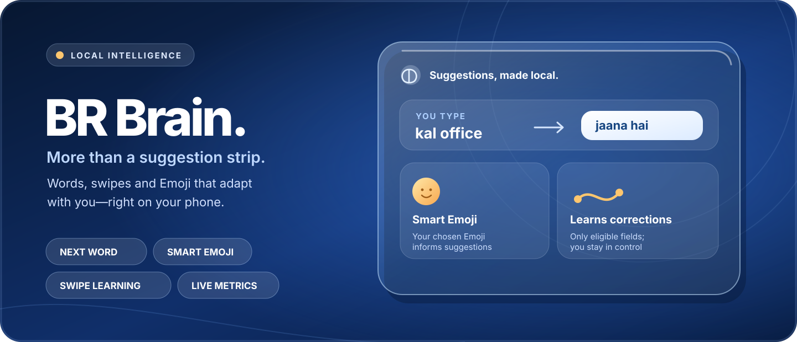
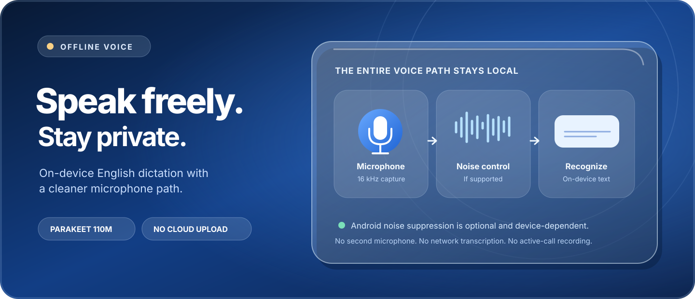
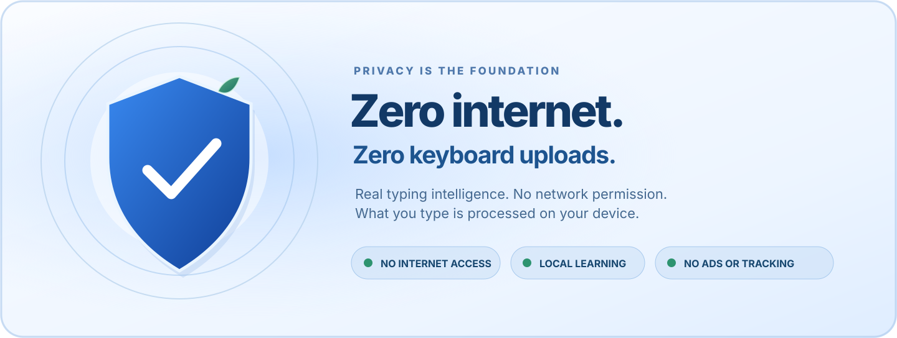
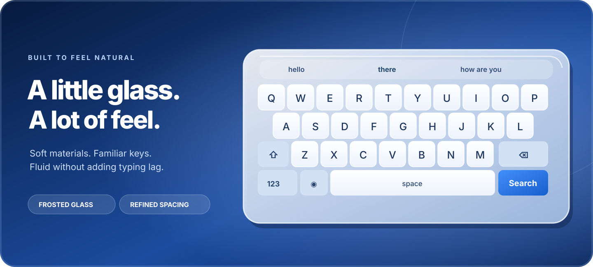
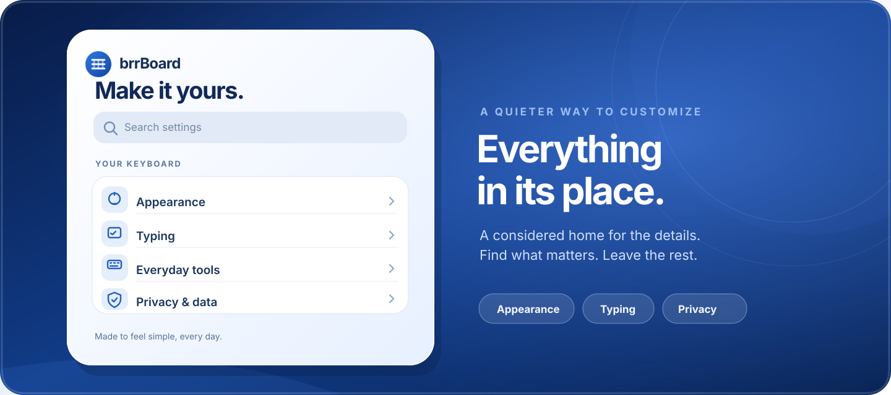

<picture>
  <source media="(prefers-color-scheme: dark)" srcset="art/brand/mangoloads/readme-hero-dark.png">
  
</picture>

# brrBoard

### Intelligent. Private. Beautiful.

**BR Brain · Private offline voice · Zero internet · iOS-inspired frosted glass**

brrBoard is a thoughtfully crafted Android keyboard by [MangoLoads](https://batmancpu.github.io/mangoloads/). It brings together adaptive on-device typing intelligence, private English voice dictation, a beautifully restrained frosted-glass interface, and the everyday tools you actually use. No account. No cloud keyboard. No internet permission.

[**⬇ Download the latest signed APK**](https://github.com/Batmancpu/brrrBoard/releases/latest/download/brrBoard.apk) &nbsp;·&nbsp; [**Get updates with Obtainium**](docs/OBTAINIUM.md) &nbsp;·&nbsp; [Explore releases](https://github.com/Batmancpu/brrrBoard/releases)

 &nbsp; [Build recovery when the workspace proxy is unavailable](docs/LOCAL_BUILD_NETWORK_FALLBACK.md) &nbsp;·&nbsp; [Privacy policy](PRIVACY_POLICY.md) &nbsp;·&nbsp; [Open-source licenses](#made-possible-by-open-source)

---

Four reasons to switch: **intelligence that learns locally**, **voice that recognizes on-device**, **privacy enforced by the app's permissions**, and **a keyboard designed to feel as good as it looks**.

*All visuals below are original, illustrative brand concepts—not screenshots or guarantees of exact device rendering. The details are verified against current source and signed release records.*

## 01 / BR Brain. Intelligence that stays yours.

**BR Brain** is the heart of brrBoard—not a cloud service hiding behind a flashy label. It brings the keyboard's local intelligence into one place, with controls and a dashboard that make its behavior understandable.

| It understands your flow | It learns with boundaries | It shows its work |
| :--- | :--- | :--- |
| Offline word and next-word suggestions, English/Hinglish typing, and context-aware **Smart Emoji** cues. | Confirmed swipe corrections and eligible Emoji choices can improve later local suggestions. Incognito and protected fields are excluded. | The **BR Brain** dashboard exposes local processing-speed measurements, learning activity and erase controls. No cloud analytics. |

The currently shipped intelligence uses offline dictionaries, native word/gesture candidates, local learning and encrypted Emoji associations. A separate bilingual neural model is still in development; **we don't claim it is already in the APK**. This is a smarter-feeling alternative built around useful behavior, not inflated AI promises.

## 02 / A voice that doesn't need the cloud.

Tap the blue microphone for **offline English dictation**, powered by an on-device **NVIDIA Parakeet TDT 110M INT8** recognition model (once provisioned). Audio is captured privately, decoded on your phone, and inserted into your text field—without sending speech to an online transcription service.

- **Three local processing choices.** In **BR Brain → Voice & Noise Reduction**, choose brrClean, Android `NoiseSuppressor`, or raw microphone audio. New installs default to brrClean; an existing explicit choice is preserved. Android's effect is used only when supported and the app reports whether it activated.
- **Long dictation stays bounded.** The phone captures 16-kHz audio into short in-memory chunks and sends them sequentially through the isolated brrClean process and Parakeet 110M while recording continues. If brrClean fails or a chunk is outside its processing limit, that audio falls back to raw Parakeet input. Text is inserted only after capture finishes and the original editor is still safe.
- **Thoughtful safety.** Dictation is blocked when Android reports an active phone or video call. The normal blue mic prefers the built-in phone input; The keyboard uses one verified microphone input and does not combine phone and earbud microphones.
- **Private diagnostics.** A one-session troubleshooting tool can record only sanitized stages and timings—not audio, transcripts, app names or typed words.

The recognition model is provisioned locally and runs on-device. A first-time installation may need the special model-inclusive bootstrap described [below](#before-using-voice-or-swipe). brrClean is bundled with the app; neither model is fetched at runtime. Noise reduction has not been shown to improve recognition accuracy on every device or in every environment.

## 03 / Zero internet. Zero keyboard uploads.

This is the part that changes the equation: **brrBoard does not request Android's `INTERNET` permission.** Its [app manifest explicitly removes internet and network-state permissions](app/src/main/AndroidManifest.xml). The keyboard cannot quietly upload your typing, learned words, Clipboard history or microphone recordings to a server.

- **Suggestions stay on-device.** BR Brain processes eligible typing and learns locally, with protected and incognito exclusions.
- **No ads, tracking SDK or cloud keyboard account.** Your personal dictionary and Clipboard history live on your phone.
- **Offline voice when provisioned.** Speech recognition uses a locally stored model; no automatic model download or cloud transcription by brrBoard.

Opening an external link uses another app, and **you can deliberately export or share a local backup**—that is not the keyboard secretly transmitting data. The [privacy policy](PRIVACY_POLICY.md) explains those boundaries precisely.

---

## 04 / A little more feeling. A lot less noise.

This is the visual signature: **iOS-inspired key geometry**, clean spacing, translucent materials, restrained blue action-key accents and a suggestion strip that doesn't fight your words. Native background blur is used where the Android device supports it; carefully chosen fallbacks keep typing dependable elsewhere.

<picture>
  <source media="(prefers-color-scheme: dark)" srcset="art/brand/mangoloads/readme-material-dark.webp">
  
</picture>

The frosted look has a purpose: a comfortable visual rhythm that feels at home on Android without slowing the typing path. Clear hierarchy, useful contrast, restrained movement. The keyboard, Toolbar, Emoji and Clipboard surfaces each get the treatment they need—not the same effect everywhere. The **Frosted Glass Studio** gives you live preview and separate light/dark adjustments with deliberate Save/Cancel behavior.

*Glass material studies above are design artwork, not a claim of optical refraction or a real phone screenshot.*

## 05 / Everything in its place.

The Settings home groups what belongs together: **Make it yours**, **Typing**, **Everyday tools**, and **Privacy & data**. Find a control with Settings search; fine-tune appearance and frosted glass without making a simple preference feel complicated.

**Personalization is there when you want it.** The keyboard should disappear into your day when you don't.

## 06 / The little things are the big things.

| Thoughtful typing | Close-at-hand tools | Yours to control |
| :--- | :--- | :--- |
| English and Hinglish layouts, suggestions, a personal dictionary and editing shortcuts. | Searchable Emoji, locally stored Clipboard history and optional offline voice transcription when a model is provisioned. | Keyboard appearance, layout, privacy choices and separately imported gesture-typing support. |

One blue keyboard. One mango. An identity carried through the launcher, first-run setup, and About—without unnecessary animation in the typing path.

### More details worth caring about

| Typing and editing | Everyday tools | Privacy and control |
| :--- | :--- | :--- |
| English/Hinglish layouts, autocorrect, next-word suggestions, personal words and editing shortcuts. | Searchable Emoji with Smart/Recent suggestions, Clipboard history, search and locally stored image previews. | Protected-app Incognito behavior, confirmation for sensitive clearing, and locally controlled learning. |
| Gesture trails and swipe correction learning **when a compatible offline gesture library is installed**. | Toolbar shortcuts, sound/haptic feedback and keyboard configuration close at hand. | In-app backup/restore, granular appearance controls, private voice diagnostics and no internet permission. |

---

## Make it your keyboard.

### Download brrBoard for Android

The installable package is the **original-signed release APK**. Download it from the [latest release page](https://github.com/Batmancpu/brrrBoard/releases/latest) or use the direct [latest `brrBoard.apk` link](https://github.com/Batmancpu/brrrBoard/releases/latest/download/brrBoard.apk). The current published release is **v1.0.251**; its APK is 63,511,404 bytes and SHA-256 is `9f0f4f609beadfede67a5e11b885d7cdc12cbb4e36e0b84f863fa55892f5bf17`. The release notes and assets are on the [v1.0.251 page](https://github.com/Batmancpu/brrrBoard/releases/tag/v1.0.251).

1. Download `brrBoard.apk` from that release page. Do not install an Actions debug artifact as a replacement for the signed release.
2. If Android blocks the installer, allow **Install unknown apps** for the browser or file manager you used, then return to the APK and install it. Android may ask you to confirm an update from the same signer.
3. Open brrBoard and follow **Enable keyboard** in the setup wizard. Review the [privacy policy](PRIVACY_POLICY.md) and Android's input-method warning before enabling any keyboard.
4. Choose **Switch to brrBoard** in the wizard or select it from Android's keyboard picker.

For automatic signed updates, add [`https://github.com/Batmancpu/brrrBoard`](https://github.com/Batmancpu/brrrBoard) to [Obtainium](docs/OBTAINIUM.md). Keep the same app package and signing identity for in-place updates. A new APK is available only after the exact-source build and original-signer release workflow passes; commits, draft PRs, and debug artifacts are not published releases.

The normal update does not include large speech-recognition weights: an already-installed private voice model is reused. A first-time installation or deliberate model recovery uses the separate model-inclusive bootstrap described [below](#before-using-voice-or-swipe).

For straightforward signed updates, add [`https://github.com/Batmancpu/brrrBoard`](https://github.com/Batmancpu/brrrBoard) to [Obtainium](docs/OBTAINIUM.md). Keep the same app package and signing identity for in-place updates.

## Your data, in plain language.

The words you type belong to you. Here's how the privacy promise works in practice:

- **No internet permission requested by brrBoard.** It does not include ad tracking or a payment/donation feature.
- **Keyboard data is local.** Settings, learned words, personal dictionaries and Clipboard history are stored on your device. Some optional features may access contacts only with appropriate device permissions.
- **Voice is deliberate and offline.** Tap the microphone to record, then tap again to transcribe; hold-and-release recording is also available. Audio is processed using a locally provisioned English recognition model, not sent to a transcription server by the keyboard.
- **Backups are private.** A manually exported backup ZIP may contain personal words and Clipboard content; it is **not encrypted**. Keep it somewhere safe.

Read the full [brrBoard privacy policy](PRIVACY_POLICY.md) for precise behavior and limitations.

### Before using voice or swipe

The standard signed update is designed to **reuse** an offline voice model already stored privately by brrBoard; it does **not** bundle about 136 MB of duplicate weights every time. A maintainer-triggered model-inclusive Obtainium build is needed for first-time provisioning or recovery. There is no automatic model download on the phone.

Gesture typing can use a separately imported, compatible offline library. It is not silently bundled into every install. See the in-app Gesture Typing setup for your device's available options.

## Coming from an older brrBoard?

The current app package is **`com.mangoloads.board`**. Older installations using `com.orion.frostkeys.brrrboard` are a *different* Android package and cannot be upgraded in place to the new ID.

1. In the old app, export **Settings → Backup and restore** to a local ZIP.
2. Install the new signed brrBoard APK, but keep the older installation until you've checked your data.
3. In the new app, restore your backup and verify preferences, personal words and any imported gesture library.
4. Enable the new keyboard in Android settings. Only remove the old installation when everything works as expected.

Do not share the unencrypted ZIP publicly.

## Good to know

Does brrBoard require internet access?

The keyboard itself does not request Android internet permission. Opening a GitHub or website link hands that action to your browser or another application.

Is BR Brain an online AI service?

No. Its current word/next-word suggestions, native swipe candidates, local correction learning and Smart Emoji associations run on the device. The separately planned bilingual neural ContextLM is not yet trained or installed; we don't claim unverified model accuracy or superiority over another keyboard.

What does brrClean do, and can it combine phone and earbud microphones?

brrClean is an offline GTCRN denoiser that runs in an isolated process before Parakeet 110M transcription. Android `NoiseSuppressor` and raw microphone audio are also available in BR Brain. A denoising failure falls back to raw audio. The keyboard does not fuse separate phone and earbud microphone streams; Android or the device manufacturer controls microphone routing and may silence concurrent capture. Noise reduction is not a guarantee of better recognition accuracy.

Why does Android warn me when I enable the keyboard?

Android displays a standard trust prompt for input methods because a keyboard can observe what you enter into editors. Review the app permissions and [privacy policy](PRIVACY_POLICY.md) before deciding.

Why might offline voice be unavailable on a new install?

Normal incremental APKs omit the model weights. The private recognition model must first be supplied in a deliberate, signed bootstrap/recovery APK. The app does not download those weights automatically.

Can I import swipe typing support?

Yes, compatible offline gesture-typing libraries can be imported through settings. Availability and licensing are separate from the brrBoard APK. Check the in-app Gesture Typing page for the supported import workflow.

Is a local backup encrypted?

No. A backup may include learned words and Clipboard history. Treat it as sensitive and delete copies you no longer need.

## Under the hood

brrBoard is an open-source Android project. The [contribution guide](CONTRIBUTING.md) explains the current repository and privacy-conscious testing approach. For technical details, see the [documentation index](docs/README.md), the [source-based feature priority audit](docs/README_FEATURE_PRIORITY_AUDIT_2026_11_21.md) and the [current engineering checkpoint](PROJECT_CONTEXT.md).

The repository currently has public GitHub Issues disabled. We won't send people to a nonworking issue form; please check this repository for an available support channel. If a public tracker is enabled later, that section will be updated.

## Made possible by open source

brrBoard is a MangoLoads continuation of open-source [FrostKeys](https://github.com/AshwinSoni-01/FrostKeys), HeliBoard, OpenBoard and AOSP LatinIME. We keep their required source and asset attributions intact. See [GPL-3.0](LICENSE), [Apache notices](LICENSE-Apache-2.0), [asset license](LICENSE-CC-BY-SA-4.0) and [NOTICE](NOTICE).

*Designed with care for Android. Apple and Gboard are not affiliated with or endorsing this project.*
