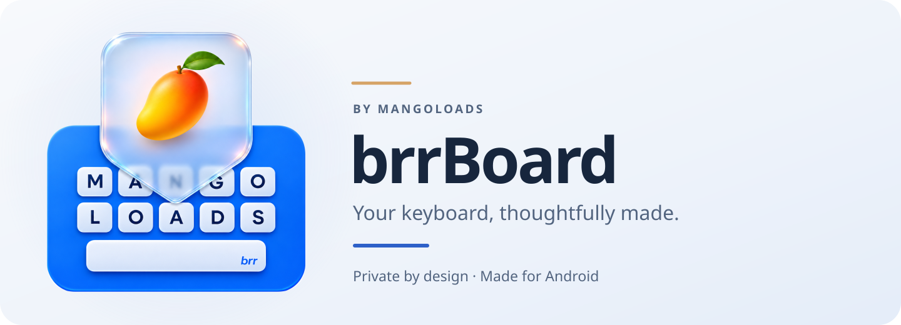
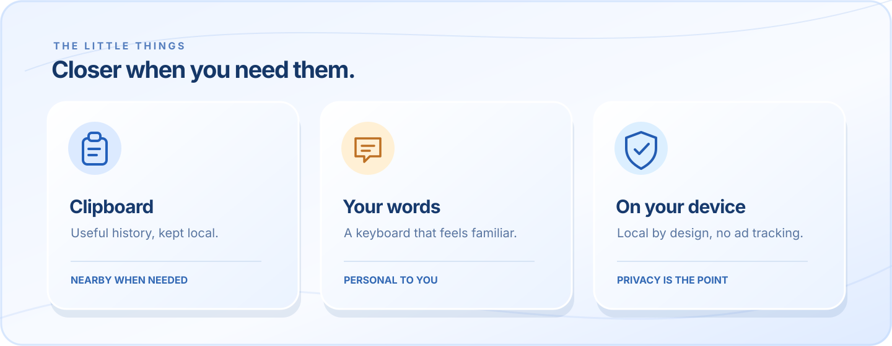

<picture>
  <source media="(prefers-color-scheme: dark)" srcset="art/brand/mangoloads/readme-hero-dark.png">
  
</picture>

# brrBoard

### Your keyboard, thoughtfully made.

Beautifully familiar. Quietly capable. Unmistakably yours.

brrBoard is a local-first Android keyboard by [MangoLoads](https://batmancpu.github.io/mangoloads/), made for the moments when you just want to type. Considered glass surfaces, responsive controls, English and Hinglish typing, and everyday essentials—without turning your keyboard into a spectacle.

[**⬇ Download the latest signed APK**](https://github.com/Batmancpu/brrrBoard/releases/latest/download/brrBoard.apk) &nbsp;·&nbsp; [**Get updates with Obtainium**](docs/OBTAINIUM.md) &nbsp;·&nbsp; [Explore releases](https://github.com/Batmancpu/brrrBoard/releases)

 &nbsp; [Privacy policy](PRIVACY_POLICY.md) &nbsp;·&nbsp; [Open-source licenses](#made-possible-by-open-source)

---

## A little more feeling. A lot less noise.

<picture>
  <source media="(prefers-color-scheme: dark)" srcset="art/brand/mangoloads/readme-material-dark.webp">
  
</picture>

The frosted look has a purpose: a comfortable visual rhythm that feels at home on Android without slowing the typing path. Clear hierarchy, useful contrast, restrained movement. The keyboard, Toolbar, Emoji and Clipboard surfaces each get the treatment they need—not the same effect everywhere.

> *Design imagery throughout this page is illustrative brand artwork, not a claimed device screenshot. Real product screenshots will follow device verification.*

## Everything in its place.

The Settings home groups what belongs together: **Make it yours**, **Typing**, **Everyday tools**, and **Privacy & data**. Find a control with Settings search; fine-tune appearance and frosted glass without making a simple preference feel complicated.

**Personalization is there when you want it.** The keyboard should disappear into your day when you don't.

## The little things are the big things.

| Thoughtful typing | Close-at-hand tools | Yours to control |
| :--- | :--- | :--- |
| English and Hinglish layouts, suggestions, a personal dictionary and editing shortcuts. | Searchable Emoji, locally stored Clipboard history and optional offline voice transcription when a model is provisioned. | Keyboard appearance, layout, privacy choices and separately imported gesture-typing support. |

One blue keyboard. One mango. An identity carried through the launcher, first-run setup, and About—without unnecessary animation in the typing path.

---

## Make it your keyboard.

1. **[Download `brrBoard.apk`](https://github.com/Batmancpu/brrrBoard/releases/latest/download/brrBoard.apk)** from the latest GitHub release. Android may ask your browser or file manager for permission to install the APK.
2. Open brrBoard and follow **Enable keyboard** in the setup wizard. Android's input-method warning is a normal security reminder; please review the [privacy policy](PRIVACY_POLICY.md) before enabling any keyboard.
3. Choose **Switch to brrBoard** in the wizard or Android's keyboard picker. You're ready to type.

For straightforward signed updates, add [`https://github.com/Batmancpu/brrrBoard`](https://github.com/Batmancpu/brrrBoard) to [Obtainium](docs/OBTAINIUM.md). Keep the same app package and signing identity for in-place updates.

## Privacy isn't a feature toggle.

The words you type belong to you. brrBoard is built around on-device behavior and straightforward permissions.

- **No internet permission requested by brrBoard.** It does not include ad tracking or a payment/donation feature.
- **Keyboard data is local.** Settings, learned words, personal dictionaries and Clipboard history are stored on your device. Some optional features may access contacts only with appropriate device permissions.
- **Voice is deliberate and offline.** Tap the microphone to record, then tap again to transcribe; hold-and-release recording is also available. Audio is processed using a locally provisioned English recognition model, not sent to a transcription server by the keyboard.
- **Backups are private.** A manually exported backup ZIP may contain personal words and Clipboard content; it is **not encrypted**. Keep it somewhere safe.

Read the full [brrBoard privacy policy](PRIVACY_POLICY.md) for precise behavior and limitations.

### Before using voice or swipe

The standard signed update is designed to **reuse** an offline voice model already stored privately by brrBoard; it does **not** bundle about 136 MB of duplicate weights every time. A maintainer-triggered model-inclusive Obtainium build is needed for first-time provisioning or recovery. There is no automatic model download on the phone.

Gesture typing can use a separately imported, compatible offline library. It is not silently bundled into every install. See the in-app Gesture Typing setup for your device's available options.

## Coming from an older brrBoard?

The current app package is **`com.mangoloads.board`**. Older installations using `com.orion.frostkeys.brrrboard` are a *different* Android package and cannot be upgraded in place to the new ID.

1. In the old app, export **Settings → Backup and restore** to a local ZIP.
2. Install the new signed brrBoard APK, but keep the older installation until you've checked your data.
3. In the new app, restore your backup and verify preferences, personal words and any imported gesture library.
4. Enable the new keyboard in Android settings. Only remove the old installation when everything works as expected.

Do not share the unencrypted ZIP publicly.

## Good to know

Does brrBoard require internet access?

The keyboard itself does not request Android internet permission. Opening a GitHub or website link hands that action to your browser or another application.

Why does Android warn me when I enable the keyboard?

Android displays a standard trust prompt for input methods because a keyboard can observe what you enter into editors. Review the app permissions and [privacy policy](PRIVACY_POLICY.md) before deciding.

Why might offline voice be unavailable on a new install?

Normal incremental APKs omit the model weights. The private recognition model must first be supplied in a deliberate, signed bootstrap/recovery APK. The app does not download those weights automatically.

Can I import swipe typing support?

Yes, compatible offline gesture-typing libraries can be imported through settings. Availability and licensing are separate from the brrBoard APK. Check the in-app Gesture Typing page for the supported import workflow.

Is a local backup encrypted?

No. A backup may include learned words and Clipboard history. Treat it as sensitive and delete copies you no longer need.

## Under the hood

brrBoard is an open-source Android project. The [contribution guide](CONTRIBUTING.md) explains the current repository and privacy-conscious testing approach. For technical details, see the [documentation index](docs/README.md) and the [current engineering checkpoint](PROJECT_CONTEXT.md).

The repository currently has public GitHub Issues disabled. We won't send people to a nonworking issue form; please check this repository for an available support channel. If a public tracker is enabled later, that section will be updated.

## Made possible by open source

brrBoard is a MangoLoads continuation of open-source [FrostKeys](https://github.com/AshwinSoni-01/FrostKeys), HeliBoard, OpenBoard and AOSP LatinIME. We keep their required source and asset attributions intact. See [GPL-3.0](LICENSE), [Apache notices](LICENSE-Apache-2.0), [asset license](LICENSE-CC-BY-SA-4.0) and [NOTICE](NOTICE).

*Designed with care for Android. Apple and Gboard are not affiliated with or endorsing this project.*
