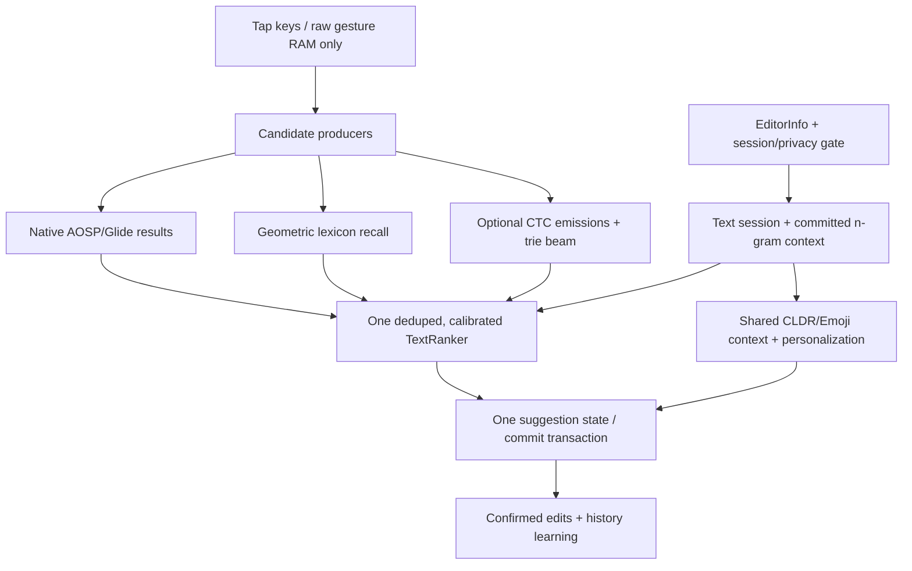

# brrBrain v2 — independent swipe candidate generation + adaptive text/Emoji + optional per-app context

**Status: revised implementation DESIGN ONLY; DO NOT implement until owner says GO.** 18 November 2026, India. This file **supersedes the architecture and T0–T6 stage definitions** in `docs/ADAPTIVE_TYPING_EMOJI_AND_SNAP_HANDOFF_2026_11_18.md`. Preserve its detailed Emoji insertion, post-Space, snap-height, privacy and regression requirements where consistent with this revision. Do not use the old plan's *native-top-three-only* swipe ranking restriction: the owner has now reported that the intended swipe word is sometimes absent from *every* suggestion.

## 0. Product decision, exact owner examples and hard constraints

The owner reports on Oppo Reno 10 5G:

1. Swiping **happy** can yield a nonsensical word resembling `japt`/`zapt`, or only the partial `hap`. Sometimes `happy` appears as a secondary suggestion; selecting it then predicts `birthday` (useful); selecting `birthday` then leaves the strip empty. Other intended swipe words are absent from the entire candidate list, forcing manual typing. Treat these as distinct failure modes: *missed candidate recall, poor rank, incomplete gesture/partial word, and missing legitimate post-boundary predictions*. Record the exact phone output in T0; do not assert a diagnosis from the transcribed example.
2. `happy` + strip Emoji currently replaces `happy`; `happy ` suppresses contextual Emoji; Space/Enter sometimes empties all predictions. An Emoji action must **append**, whereas selecting a text correction may replace the composing word. After Space, allow **native/learned next-word text plus one high-confidence contextual Emoji**. Do not manufacture a prediction if the language model genuinely has no credible continuation.
3. Learn from **missed swipe -> manually typed intended word**, not only when the intended word appeared in the old top three. Adapt to thick-thumb imprecision without changing every swipe on one anecdote. Also learn contextual Emoji and ordinary accepted words.
4. The owner explicitly permits a **tiny on-device ML encoder**, preferably around 10 MB and at most **20 MB of added packaged model/runtime footprint**, only if measured accuracy and speed justify it. The model must work offline; it is an encoder/decoder, **not a chat-style AI agent**. Avoid speculation about “100% more accurate every use.”
5. Explore **per-app style/context**: the keyboard can receive `EditorInfo.packageName` (Android validates package/UID from API 23), `inputType` and `imeOptions`. Use this solely for an **optional, local, opt-in scoped ranking prior**, never application surveillance, typed-message storage or installed-app scanning. Password/incognito/no-personalized-learning fields always bypass it.
6. One **brrBrain** orchestration contract with two knowledge domains: **Text** (tap/autocorrect/next-word/swipe/lexicon/user feedback) and **Emoji** (CLDR/search/context/usage). A geometric/CTC swipe provider is a *candidate source inside Text*, not a third detached intelligence stack; all text channels share one ranking/commit-state contract.
7. Preserve `com.mangoloads.board`, original pinned-signature Obtainium updates, `main` only, no force pushes, no new network permission, approved iOS glass/footer/typing geometry, Emoji/Clipboard snap switch, all supported ABIs and 16 KB page compliance. Keep concurrent Dictate/voice/provider files untouched. No release during planning.

At planning start, last verified *runtime* baseline was original-signed **v1.0.129**, app commit `e905624632ee70dd0b344930402b9d0c0ca229e2`; debug `44355485307`, signer `44355485966` SUCCESS. The first design-only handoff is main `c35c325ba54e65aa8aec4a0c43684b23cbc6c095`. Re-read live HEAD, workflows and release before GO; these IDs can age.

## 1. Source-grounded limitations: why prior candidate-only fix is insufficient

- Current source uses HeliBoard/AOSP `InputLogic.java` -> `InputLogicHandler.java` -> `WordComposer` / `InputPointers` -> `Suggest.kt` -> `DictionaryFacilitatorImpl.kt` -> native `BinaryDictionary.java.getSuggestionsNative`. Batch mode sends x/y/timestamps/IDs and n-gram context to the imported gesture-capable `libjni_latinimegoogle.so` when present. The imported library is **user supplied**, not an editable or redistributable Gboard engine; `GestureLibraryImport.kt` stages an arm64 module with checksum and `JniUtils.java` loads it or falls back to built-in AOSP. `GestureConsumer.java` is not the active pipeline.
- `DictionaryFacilitatorImpl.getSuggestionResults` merges dictionary groups and filters garbage swipe outputs with `dictionary.isInDictionary`. **Check the pre/post-filter candidate lists and locale source**: an intended native result may be pruned or a rare alternate-language result may be over-ranked. This is a hypothesis to test, not proof that `japt` came from Hindi.
- A top-three confusion correction table **cannot produce `happy` when no decoder produced it**. The text engine therefore needs a **second independent candidate generator or a new decoder**, followed by shared calibration; returning only existing native candidates will not satisfy the owner's example.
- Existing native `UserHistoryDictionary` already learns accepted words and bigrams; do not build a duplicate unigram database. `BinaryDictionary.getNextWordProperty(token)` enumerates dictionary words through JNI, so a **background-only lexicon extraction/compact trie experiment** may reuse bundled language dictionaries rather than shipping duplicate 3 MB word lists. Verify memory, frequency metadata and duration; never enumerate on the typing thread.
- Current APK's checked-in dictionaries include `main_en-US.dict` (~2.96 MB), `main_en-GB.dict` (~1.03 MB), `main_hi-Latn.dict` (~0.20 MB), plus Emoji dictionaries; some files are missing from the sparse local checkout but are present in GitHub's full tree and CI. Hindi-Latin and English are competing hypotheses; retain per-locale/source identity in candidate provenance.
- `Suggest.getNextWordSuggestions` has an n-gram cache which currently invalidates when main dictionaries reload but not on every learned word/history revision. `SuggestionStripView` also has visibility and layout rules. The user's `happy -> birthday -> blank` may be a legitimate sparse trigram or a stale/hidden result. Instrument before changing.
- The confirmed strip Emoji bug remains `SuggestionStripView.onClick` treating Emoji as `pickSuggestionManually` -> `LatinIME.pickSuggestionManually` -> `InputLogic.commitChosenWord`, replacing the composing word. Fix through an explicit insert action, separately from swipe reconstruction.
- Existing `EmojiDescribeIndex/Engine`, `EmojiContextScorer`, `AdaptiveEmojiEngine` and `InputLogic.addToHistoryIfEmoji` form the shared Emoji base; no new independently trained Emoji model is needed. The adaptive engine currently starts a thread per usage event; move its persistence off the IME hot path.
- `EmojiPalettesView.java` and `ClipboardHistoryView.kt` each interpolate height and delay footer ABC by ~260 ms. Remove custom springs and use final endpoint geometry via `SharedPanelGeometry`, preserve ColorOS system show/hide.

## 2. Online source comparison and the actual design decision

| Candidate | Evidence/source, license, integration | Decision |
| --- | --- | --- |
| Existing imported Google-compatible GlideLib | Closed proprietary gesture binary; HeliBoard intentionally does not bundle it; current user importer and JNI ABI are working but opaque. | **Retain as benchmark and immediate safety fallback.** Do not patch, ship or misattribute proprietary internals. |
| **CleverKeys CTC + geometric** | Open-source **GPL-3.0** keyboard; published **2.91 MB ONNX CTC encoder** with layout-aware features + trie/Viterbi beam and a separate SHARK2-style geometric fallback. Maintainer reports **89.31% top-1 on its own 2,400-swipe held-out English set**, not independently validated on brrBoard/Oppo. Its full stack uses ONNX Runtime/XNNPACK and dictionary packs; copying just a `.onnx` file is **not** a working engine. | **Preferred model-assisted prototype** after asset/training-data licensing and end-to-end size/ABI benchmarking. Reuse a reviewed minimal component under compatible licenses, not the whole app. Never promise its reported accuracy transfers. |
| `libswipetype/libswipetype` | Apache-2.0 C++17, Android JNI + HeliBoard adapter, 64-point gesture normalization and bounded DTW-to-ideal-word-path scoring. **Pre-release** and publishes targets rather than independent measured field accuracy. | **Preferred license-clear non-neural geometric reference** and second comparative candidate. Check actual code/benchmarks, not README promises. |
| FlorisBoard / OpenSwipe / CleverKeys geometric implementation | Open-source geometric algorithms, but geometry-only heuristics can overprune thick-thumb off-center endpoints; provenance, actual code and lexicon quality vary. | Study and benchmark, never cargo-cult or accept unmeasured superiority. |
| FUTO Keyboard swipe / model | Public source + novel neural decoding, but **FUTO Source First 1.1** has material redistribution/modification restrictions; model provenance differs from AOSP. | **Research reference only; exclude code and weights** unless a documented license review proves brrBoard's planned distribution allowed. |
| `proshian/neural-swipe-keyboard-android` | Primary repo documents **Russian-only** decoder and ~170 MB trie with RAM caveats. | Not suitable for lightweight English/Hinglish production. |
| New LLM/transformer assistant | A generative LM does not by itself recover gesture geometry; decoder, lexicon, runtime and privacy costs increase. | **Do not introduce.** Tiny CTC spatial encoder is enough to test the owner's ML allowance. |

Research URLs and findings are pinned in §11. **Decision:** build an **independent geometric candidate-recall provider first**, with soft endpoint penalties and shared lexicon. In parallel, integrate a **license-cleared, small CTC decoder experiment** behind a non-user-facing switch. Score existing GlideLib, geometric, CTC and combined candidates on the **same actual authored/consented gestures and identical language/layout**. Only promote CTC to default if it beats both existing and geometric on quality AND satisfies all ABI, latency, memory, privacy and *incremental signed-APK* budget gates. If it fails, ship the lightweight geometric rescue path and all semantic fixes; retain the imported native decoder as primary until its replacement is demonstrably superior.

**No blind swap:** a new engine can be worse at capitalization, contractions, Hinglish, custom layouts, split mode, multibyte Emoji avoidance, CJK or long-gesture cancellation. This staged implementation is a complete redesign of the candidate boundary, not an unreviewed replacement of mature AOSP editing semantics.

## 3. Target architecture: one text decision surface and one Emoji domain

**TextCandidate** (new immutable typed contract): `word`, `locale`, `kind` (swipe/typed/next), `source`, `rawSpatialOrCTCScore`, `nativeLanguageScore`, `lexiconFrequency`, `contextScore`, `personalScore`, `appScopeScore`, `confidence`, `generation`, `isOffensive/isProtected`, `isUserWord`. Never compare arbitrary raw native/CTC/DTW scores directly; fit **source-specific monotonic calibration** (temperature/quantile mapping) from a held-out validation set, then combine log-scores under explicit bounded weights. Preserve source/provenance through dedup and blacklisting. No `getTextBeforeCursor` call per frame or string logging in release.

**Word candidate generator**: keep a compact trie/DAFSA per supported locale with frequency rank and user-word overlay. Build off-thread from existing dictionary enumeration where feasible, validate native lock/thread safety; if enumeration is unsafe or too slow, generate a **license-reviewed compressed top-N lexicon** at build time and include it only if the final APK budget stays green. Never duplicate all locale dictionaries. Candidate generator must include common `happy` even when imported JNI has no such proposal; at minimum emit top 10–20 lexical words internally, even though only 2–3 text options can appear in the strip.

**Geometric rescue**: consume a temporary copy of completed `InputPointers` with actual current key centers/size (including one-handed/floating/landscape offsets). Deduplicate jitter, arc-length resample ~32–64 points, normalize against visible layout, recognize pause/corner/repeated-letter cues, use **soft** start/end priors (not hard exact first/last key), soft keyboard proximity, bounded-band DTW or edit-distance-on-key-probability-lattice, and beam/pruning over trie prefixes. Apply strict operation cap and cancellation/generation token. Return scored lexical candidates, never free-form random sequences. An intentionally incomplete gesture ending at `p` may yield `hap`/`happy` if confidence and suffix cost warrant it; do not simply append `py` to everything.

**CTC experiment**: convert swipe x/y, normalized key geometry, velocity and acceleration to exactly the expected tensor shape/normalization of the *pinned* model; ONNX Runtime limited build with only its needed operators and XNNPACK if benchmarking supports it. Decode emissions through trie-constrained CTC prefix/beam (collapsed repeated letters and blanks); accommodate `happy`'s repeated `p` and terminal `y`. Warm session lazily off UI; no inference per pointer event, no model run on every ordinary tap. Keep CTC unavailable on unsupported ABI/locale/layout without breaking typing. Validate copied model license, training-data rights, hash, provenance and R8 keep rules before packaging.

**Joint ranker**: dedupe by normalized `(locale, word)`, calibrate producer scores, add `P(word | previous words)` from native ngram/user history; use language confidence/locale, recency, accepted corrections and optional app profile as *bounded priors*. Heavily penalize unsupported rare-garbage outputs unless user explicitly learned them, while preserving slang and names deliberately accepted by the owner. Never silently switch to an unrelated language purely due to a rare geometric path match. Promote top-1 only with calibrated margin/coverage; if uncertain preserve editable composing top candidate and accessible alternatives. If no input word is credible, show safe prefix/proximity candidates rather than assert an invented correction. Preserve word user manually typed even if OOV; offer Add-to-Dictionary per existing behavior.

**Prediction and Emoji**: Next-word-only state after Space/valid Enter uses the same accepted-word context and TextRanker; normal lexical n-gram and curated fallback *only if model can back it*. Emoji is a separate `INSERT_EMOJI` action chip with one high-confidence accessory slot, not a fake text candidate; Search/strip/panel share one CLDR and learned topic ranker. One UI updater owns generation/order so stale native/CTC/Emoji async callbacks cannot clear or overwrite a newer strip.

## 4. Revised T0–T6 implementation sequence — one approved GO work session, gated commits

### T0 — Reproduce, freeze real outputs and prove candidate absence

1. Refresh `main`, original-signed release, active GitHub Actions and overlapping Dictate paths. Capture full source tree, including ignored/sparse JNI and `assets/dicts`, before editing. Compare `main` to old handoff commit. No git reset/force push.
2. Add debug/test-only counters to `InputLogicHandler`, `Suggest`, `DictionaryFacilitatorImpl`, `SuggestionStripView`: swipe pointer count, locale/layout, native pre/post-filter candidate **count**, first/last key distance **aggregates only**, top-1/top-3 *fixture expected ID*, text-vs-Emoji count, cache revision, UI visibility, computation time. Do not print actual words, gesture points, package names or user text.
3. Create **authored synthetic** trace fixtures in `GlideReplayHarness`: `happy` complete, early lift `hap`, off-center H/A/P/Y, thick thumb close keys, looping/doubled P, W-shaped ambiguity, single-letter hit, varied speed, fast cancellation, common Hindi-Latin overlaps. Include current compact/expanded typing geometry, English US/UK and Hindi-Latin. Label expected word and not-present-in-native baseline explicitly.
4. Make test-only adapters to actual imported/native decoder (when available on authorized device), geometric implementation and optional CTC; same gestures and same lexicon for fair comparison. Add at least 300 authored or properly licensed disjoint gesture cases, with difficult/short/long/near-key and OOV strata. **No owner raw swipe capture/upload without separate explicit consent; no generic production data collection.** Record what is only an authored simulation vs actual measured JNI output.
5. In an owner-controlled 30-second Oppo acceptance flow, reproduce `happy` swipe -> actual emitted token -> suggestions -> select `happy` -> `birthday` -> after-space strip; compare with ordinary tap input and typing in another app. Obtain no screenshots/logs containing private messages; user can choose a test editor with synthetic phrases. If phone unavailable, mark **Oppo-unknown**.
6. Gate: baseline actual native missing-recall rate, top-1/top-3, next-word coverage, pre/post-filter count, cold/warm memory, end-of-gesture p50/p95, app package/version and ABI. Do not infer quality from harness's fake Decoder.

### T1 — Repair commit semantics and prediction state machine (before decoder experiments)

1. In `SuggestionStripView.kt`, distinguish `SuggestedWordInfo.isEmoji` -> `onInsertEmoji` action, not `pickSuggestionManually`. In `LatinIME.java`/`InputLogic.java`, transactionally finish `happy` **as typed**, preserve editor selection policy, avoid duplicated Space, commit multi-codepoint Emoji, update Recents/learning only after accepted insert, reset predictions safely; use normal Emoji panel insertion semantics for selected host text.
2. In `Suggest.kt` and dictionary facilitator, invalidate n-gram prediction cache **on accepted history changes**, not every key; preserve generation token so an older async empty result cannot erase a newer nonempty strip. In `InputLogic.performUpdateSuggestionStripSync`/handler, request next-word results after Space and only after Enter that does not submit/close editor.
3. In `SuggestedWords`/`SuggestionStripView`, project preceding accepted phrase to high-confidence Emoji scorer **after Space**, reserve up to two next-word text positions and one explicit Emoji action; preserve center text, toolbar, accessibility, no-suggestion/password fields. `happy ` must allow `birthday` if actual ngram supports it and optional general Emoji; `happy birthday ` must allow 🎂/🎉 if eligible. `birthday ` may legitimately have no text next word but still show appropriate contextual Emoji if private-field gates allow.
4. Add regression for `happy` + 🎉 => `happy 🎉`, `happy ` + 🎉 => no double Space, independent next word `birthday`, Enter action SEND/SEARCH/DONE and editor switch, no stale suggestions, selected span, skin tones/ZWJ.

### T2 — Build independent swipe candidate recall, then optional 2.91 MB CTC provider

1. Add packages under `app/src/main/java/helium314/keyboard/latin/brain/`: `TextCandidate`, `BrainSession`, `SwipeDecoder` interface, `SwipeCandidateBroker`, `TextCandidateRanker`, `LexiconProvider`, `SwipeGeometryDecoder`, `SwipeDecodeMetrics` (debug only). Keep existing AOSP input state, dictionary and native JNI methods; do **not** replace original editing/WordComposer lifecycle.
2. `NativeGlideProvider` adapter wraps the existing path and preserves `mAutoCommitSequenceNumber`/`mInBatchInput` cancellation semantics. `GeometryGlideProvider` runs off UI thread against a bounded prefix trie. Collect up to 20 candidate strings internally from each source, dedup safely, show only useful text choices. Candidate creation is now **possible independently of native top three**.
3. Initial deployment: geometry is a fallback/rescue on native low confidence or candidate deficit, preferably parallel only after the gesture ends. Do not spend neural inference on every pointer move. Ensure it can rescue `happy` from a native `japt`/`hap` result **in test**, but measure false promotions on similar genuine words.
4. CTC reference candidate: pin vetted CleverKeys GPL-3.0 compatible code/model versions and all required copyright/model notices or implement the published *algorithm* independently without copying unlicensed assets; create `CtcGlideProvider` only after legal provenance check. Test whether custom reduced-operator ONNX Runtime AAR supports **minSdk 24, target 36, Gradle/Kotlin/NDK 28, all four existing ABIs and 16 KB page alignment**. Validate arm64 Reno10 plus emulator x86/x86_64 and 32-bit paths; fallback geometry if an ABI lacks runtime. Do not silently change APK to arm64-only.
5. Size gates: measure **delta of compressed original-signed Obtainium APK**, not just model weight. Target ≤10 MB added, hard cap **20 MB additional APK bytes including model, ONNX libraries, extra lexicon, licenses and runtime**; record installed memory and startup/init. If no legal, quality or size fit, drop CTC **without delaying T1/T3/T4 fixes**.
6. Add per-decoder calibration and scoring unit tests, source provenance/casing Unicode tests, failure injection for corrupt/missing model, 100 repeated gesture cancellation and orientation changes. Preserve old native runtime as a rollback selection without asking user to reimport the library.

### T3 — Learn intended words even if not previously suggested; optional per-app scoping

1. Add a `SwipeRecoveryTransaction` in `InputLogic`/`InputLogicHandler` with editor generation, locale, layout, candidate set, just-completed swipe word, rejection state and **RAM-only** normalized path summary. Expire at editor change, new swipe, cursor motion, paste, keyboard mode change or proposed max 8 seconds / two word commits. Never assume an unrelated deletion means a correction.
2. **Strong evidence:** selecting `happy` from strip after wrong native output, including candidate produced by Geometry/CTC. **Moderate evidence:** same-editor explicit rejection of completed swipe followed immediately by manually typing and committing `happy` as one word while recovery transaction still valid. Weak mere acceptance increments existing native history once but never creates a wrong->right label. If no clear link, do **not** train shape from it.
3. On valid recovery: strengthen `happy` in existing `UserHistoryDictionary` once with its prior ngram; optionally add owner-approved OOV word to personal overlay (after validation); decrement/unlearn wrong output per existing AOSP rejection rules; persist small `(locale, wrong, right)` confusion metadata (max 256) and **coarse quantized path prototype for explicitly confirmed corrections only** (max 128, fixed <=64 bytes each, no timestamps). This limited *spatial feature summary* differs from keeping raw touch traces; it can still reveal chosen words, so gate by explicit consent, encrypt in app-private credential storage or exclude from backup, reset on key loss, and never export by default.
4. For repeated similar swipes, retrieval uses small kNN/DTW to those 128 accepted prototypes **only after gesture end** with hard candidate/CPU cap. This generates a candidate even when neither old native top three nor current beam found it, but the model must verify that the prototype is geometrically and linguistically compatible. Expire with 30–60-day half-life and ≥2 independent confirmations before promotion; never force rare/unrelated previously learned words into top-1. Prototype retrieval OFF automatically if perf or accuracy gate fails.
5. A separate optional, bounded **key-center bias** may learn per-key mean offsets/covariance **only** from high-confidence aligned accepted gestures across many sessions; store aggregates, not traces. Clamp to a fraction of key pitch and require >20 samples/key; compare corrected vs untouched holdout before enabling. Do not call native JNI with permanently modified coordinates by default; all transforms must be reversible and layout-specific.
6. **Per-app context, opt-in and OFF by default**: get `EditorInfo.packageName` on `onStartInput`, no `QUERY_ALL_PACKAGES` permission and no installed-app enumeration. Maintain ephemeral session `(appId, fieldType, locale)`; optional local per-app bounded accepted word-pair/Emoji topic counts in app-private storage (e.g. max 32 app profiles with LRU, 64 item weights each), *not* message bodies or app titles. Prefer device-secret HMAC key for stored package ID (ordinary stable hash is reversible), key in Android Keystore; no cross-app profile transfer. Global user history remains as today; per-app bias only makes small candidate rank adjustments. A user-visible exclude-this-app / forget-this-app option and hard overall reset are required.
7. Require `PREF_KEY_USE_PERSONALIZED_DICTS` AND independent `PREF_LEARN_SWIPE_CORRECTIONS`; `PREF_LEARN_PER_APP_CONTEXT` separate opt-in; `PREF_LEARN_CONTEXTUAL_EMOJI` separate. Never write on incognito, sensitive input class, email/URL/OTP/password or editors with `IME_FLAG_NO_PERSONALIZED_LEARNING`, even if owner toggled on. No fetching third-party app data. App package alone cannot tell whether a particular field is safe.

### T4 — Unified Emoji learning + instant Emoji/Clipboard panel switches

1. Extend **existing** `EmojiPalettesView.AdaptiveEmojiEngine` metadata with versioned reviewed-topic→Emoji bounded counts and global freq/recency. Use `EmojiContextScorer` and `EmojiDescribeIndex` as meaning safeguards; one rank snapshot for Search, browse/Recents, strip and native last-word→Emoji ngram. No raw preceding sentences/clipboard contents persisted. Dedup usage receipt once per successful keyboard insert; undo immediate deletion may cancel pending learning.
2. Replace one-Thread-per-Emoji use with one serial background worker, coalesced writes, `AtomicReference` immutable cached ranks, zero JSON read/writes on per-keystroke UI and no unintended result reorder under the tapping finger.
3. Remove `EmojiPalettesView` + `ClipboardHistoryView` 260ms `ValueAnimator`/height motion/clip interpolation and `postDelayed` footer ABC. Each mode switch computes one final endpoint via `SharedPanelGeometry`/`KeyboardWrapperView`, clears clip/translation/alpha/old callbacks, calls one requestLayout and returns to ABC in the **same tap**. Keep native system IME insets animations and all approved glass, footer, pager, clipboard cards, search alphabet and swipe-to-delete.
4. Tests: `happy birthday ` shows a contextual Emoji without replacing words, CLDR exact phrase Search still ranks 🤣 for “laughing so hard I am crying,” 10 rapid Search→ABC/Expanded→ABC/Clipboard→ABC taps on Oppo with no ghost frame, jump or stale pointer target.

### T5 — Privacy, controls, storage, migrations and shipping policy

1. `Settings.java`, `Defaults.kt`, `TextCorrectionScreen.kt`, `GestureTypingScreen.kt`: understandable toggles **Learn corrected swipes**, **Learn contextual Emoji**, **Use per-app context**; all new collection modes default **OFF** until the owner opts in, even if existing personal dictionary is already ON. Explain local/on-device and why corrections can be wrong.
2. `Forget swipe adaptations`, `Forget Emoji adaptations`, `Forget this app`, `Forget per-app adaptations`, and `Clear all personalized typing` must target only their respective data, without deleting clipboard pins/custom Emoji aliases or unrelated system dictionaries. Disabling should immediately stop use *and writing*, not leave stale in-RAM sessions active.
3. Version schema (with malformed/oversized-import fail closed) for gesture confusion weights, coarse prototypes and app profiles; old user-history dict and `pref_adaptive_emoji_metadata` v1 migration preserved. New adaptation metadata target **≤192 KB** on disk outside preexisting native dictionary, no Java/ONNX model self-training on private user text. Transient raw gesture arrays are dropped after finalized decode; only explicit coarse prototypes persist when enabled. Model weights stay immutable; only bounded priors/prototypes/offsets are learned.
4. Declare what backup does: exclude per-app IDs and swipe prototypes from exported settings by default; if backup semantics would leak sensitive app usage, store in no-backup credential-protected storage and reset safely when user restores. No network/analytics/new mic permission; no app-list or clipboard learning; no production logs of words, app IDs or gestures. If encrypted storage inaccessible before unlock, disable the new learning rather than crash.

### T6 — Evaluation, quality thresholds, ABI/size/legal gates, original release and device acceptance

1. Differential tests: existing JNI vs geometry vs (optional) CTC vs hybrid, **same trace fixtures**, disjoint development/heldout; report top-1, top-3 **recall** (is intended word in candidate set), MRR, OOV recovery, false auto-replacement, per-language confusion, first/last key tolerance, candidate coverage after Space, Emoji insertion correctness, model corruption fallback, per-app leakage and private-field zero writes. Threshold: **no regression on protected cases**, no net top-3 loss on held-out set, demonstrable improvement on the hard-miss set, no spurious top-1 promotion when confidence low. If CTC wins average but loses common control swipes, keep gated routing rather than global switch. No cherry-picked example-only acceptance.
2. Real hardware: measure median/p95 gesture-up→strip update, slow/cold initial load, RAM allocated, dropped frames, temperature/battery over 100 consecutive gestures, resize tap-to-visible frame and model runtime crash-free behavior on Oppo Reno10; no JNI/ONNX/dictionary work on main input thread. Targets for *new overhead* p95 around **≤80 ms end-of-gesture** on Oppo and no extra per-key UI stall; adjust against measured baseline and refuse shipping if clearly worse. Record signed APK old/new bytes; hard 20 MB incremental ceiling.
3. Android and build: test API 24/26/34/35/36, arm64 Reno10, 32-bit fallback, x86_64 emulators, 16 KB page native loader (where applicable), R8 keeps, Kotlin/Compose current versions, original `com.mangoloads.board` package and keystore certificate. Missing imported Google `.so` must not crash new open engine; user-installed imported `.so` must continue working in rollback mode. No change to original signing keys or workflows just to pass a bad test.
4. Source/license: pin every external commit/artifact SHA, SPDX, training data and model redistribution grant, transitive runtime notices; preserve GPL-3.0 source obligations and Apache/third-party notices. FUTO Source First code/weights prohibited absent an explicit compatibility determination. Review GitHub dependency/supply-chain security, default-off feature and rollback setting.
5. Native JVM tests (`GlideReplayHarness`, `SwipeGeometryDecoderTest`, `CtcProviderContractTest`, `TextCandidateRankerTest`, `SwipeRecoveryTransactionTest`, `AppProfileIsolationTest`), instrumentation (`InputLogic`, suggestion-strip Emoji, lifecycle, geometry), existing CLDR regression and B16A/B16B Python gates; full GitHub debug and **original signer** run terminal SUCCESS. Device owner sees a short acceptance script, original-signed APK link/hash and compare v129→new from Obtainium; **CI green ≠ Oppo accepted**.
6. Main-only small commits after each passed gate, before each commit refresh main to preserve automated Dictate work: T0 fixtures; T1 semantic fixes; T2 geometry; T2 optional CTC only if proven; T3 adaptation; T4 Emoji/snap; T5 settings; T6 full release. Update `AGENTS.md`, `PROJECT_CONTEXT.md`, `docs/KNOWN_ISSUES.md`, this plan's status, run IDs, exact changed paths, test evidence and limitations at each checkpoint. Stop after one verified acceptable release; do not run forever.

## 5. Explicit feature modules and code touch map

| Existing or new source | Planned behavior and compatibility |
| --- | --- |
| `latin/inputlogic/InputLogic.java` | Preserve AOSP typing transactions and dictionary update; add recovery transaction, Emoji insertion branch, one decision-state generation, no false correction from arbitrary Backspace. |
| `latin/inputlogic/InputLogicHandler.java`, `WordComposer.java`, `latin/common/InputPointers.java` | Capture ephemeral completed batch geometry, test-only adapter, cancel stale async candidate results; no persistent raw trace. |
| `latin/Suggest.kt`, `latin/DictionaryFacilitatorImpl.kt`, `latin/DictionaryFacilitator.java`, `com/android/inputmethod/latin/BinaryDictionary.java` | Shared lexicon/history access, async candidate source interface, ngram revision invalidation, preserve native signature/ABI and multilocale dictionary weighting. |
| `latin/brain/{BrainSession,TextCandidate,SwipeCandidateBroker,SwipeGeometryDecoder,TextCandidateRanker,SwipeRecoveryTransaction,AppProfilePolicy}.*` (new) | Small unified Text decision surface; pure functions first; no per-key disk reads or duplicate full dictionary. |
| `latin/brain/CtcGlideProvider.*` (conditional new) + `app/build.gradle.kts`, `proguard-rules.pro` and pinned model/licenses | Only if legal, measured <20MB delta, ABI/R8 and quality gates. Geometry/native remain failover on unsupported devices. |
| `latin/LatinIME.java`, `latin/SuggestedWords.java`, `latin/suggestions/SuggestionStripView.kt` | One action type for words vs Emoji, support post-Space text + contextual chip, per-editor session/privacy; stable strip visibility. |
| `keyboard/emoji/{EmojiContextScorer,EmojiDescribeIndex,EmojiPalettesView}.*`, CLDR tests | One Emoji usage/topic scorer with local background persistence; reviewed Search semantics unchanged. |
| `keyboard/emoji/EmojiPalettesView.java`, `keyboard/clipboard/ClipboardHistoryView.kt`, `keyboard/SharedPanelGeometry.*` | Remove internal panel springs, no delayed ABC, endpoint layout and visual reset; no visual retheme. |
| `latin/settings/Settings.java`, `latin/settings/Defaults.kt`, `settings/screens/{TextCorrectionScreen,GestureTypingScreen}.kt` | 3 explicit privacy switches, per-app exclusions, reset, account for existing native learning preference. |
| `app/src/test/.../GlideReplayHarness*`, new `latin/brain/*Test`, `PostSpacePredictionTest`, `EmojiSuggestionInsertionTest`, `AppProfileIsolationTest`; `.github/workflows` only if new gates required | Deterministic baseline, synthetic fixtures, actual decoder differential adapter, privacy/perf, signed release evidence. |

File/package exactness must be confirmed at **live HEAD** before edit; sparse checkout omits `app/src/main/jni/` and `assets/dicts/` even though GitHub main has both. Do not overwrite a newer remote implementation with an older local file. No touch of Dictate/microphone/provider code or original keystore assets.

## 6. Decision matrix for the user's concrete experience

| Situation | Decoder behavior | Learning evidence | Display outcome |
| --- | --- | --- | --- |
| Swipe `happy`, imported engine emits `japt` | Geometric/CTC independently searches common-word lexicon; calibrated ranker can produce `happy` even if native omits it. | None until user acts. | `happy` in one of the accessible text slots if evidence supports it; no nonsensical top-1 merely due to multilingual rare score. |
| Swipe prematurely stops at `hap` | Soft terminal penalty and CTC/DTW trajectory can propose `happy` while `hap` stays editable. | No automatic learning from early lift. | Tap `happy` fixes it; that tap records intended word once. |
| Correct word absent; user deletes `japt` and manually types `happy` | Pending recovery transaction may pair as `japt -> happy` if same-editor, direct, time-bounded and no intervening paste/focus/cursor move. | **Moderate**, require repeated confirmations; accept word into native history and personal lexicon once. | Next similar gesture can retrieve `happy` via personal prototype/lexicon, even if native still omits it. |
| Select `happy`, next strip suggests `birthday` | Text-commit state advances ngram. | Acceptance strengthens native history. | `birthday` may appear as next word, with optionally appropriate generic Emoji. |
| Select `birthday`, next strip goes blank | Check actual ngram output, cache/visibility; avoid treating nonexistent text prediction as a bug. | Learned phrase context may strengthen on future repeats. | Fresh valid next words **when available** and high-confidence 🎂/🎉 chip if field allows. |
| Tap 🎉 after composing `happy` | Special Emoji insertion transaction, **not** replacement word commit. | Emoji topic/global usage counted only after successful insert. | `happy 🎉`, not `🎉` or double spaces. |
| Same word in chat app vs Notes app | Same baseline lexicon/native/global history; optional small scoped app profile prior. | Independent app-prior if opt-in and non-sensitive. | App-appropriate tie breaking; no unrelated-app context leakage. |
| Password, OTP, URL or private editor | Predictive/history/app adapt layers disabled per field/IME contract. | Zero persistent writes or lookbacks. | Ordinary safe editor behavior; no cross-field suggestions. |

## 7. Practical owner QA after the GO build

Use a test Notes/editor with non-private phrases:

1. Type `happy`, immediately tap 🎉, verify `happy 🎉`; then type `happy ` and verify next-word candidates or contextual chip.
2. Swipe `happy` five times naturally with your thick thumb; note if it appears **anywhere** in candidate list (not just top-1), and compare against v1.0.129. Do not log the raw gesture as a real message.
3. Deliberately swipe ambiguously once, choose `happy` if suggested; repeat. In a separate test, when it is **not** suggested, delete the wrong word and manually type `happy`, then do similar gestures 2–3 times. This tests the absent-candidate recovery path.
4. Tap `happy` prediction, then `birthday`; inspect the next suggestion strip, tap 🎂/🎉 without losing words. Enter as SEND in a chat is a distinct behavior from Space in Notes.
5. Repeat one harmless word pair in two apps with **per-app learning OFF**, then explicitly ON; verify no private editor adapts and Reset clears the scoped prior.
6. Enter Emoji Expanded/Search and Clipboard Search then hit ABC; return should be immediate without the old shrinking spring/blank wait or a glass flash.
7. Report just app version, **which of the known test cases failed**, and whether a correction was first/second/third/not suggested. Do not share real messages, passwords or touch traces.

## 8. Technical gates and stop conditions

- **Stop** if independent source/model license is not cleared, runtime/4-ABI compatibility fails, 20 MB incremental signed-APK cap is exceeded, or new engine lowers held-out top-3 recall / protected-case correctness. No silent copying of Gboard, FUTO or weights without rights.
- **Fallback** to existing native plus geometric/lexicon rescue if CTC is too slow/large; do not drop Emoji/Space fixes or instant panels because ML experiment failed. Keep prior learned history intact and migrations backward-readable.
- **Stop** if repeated correct swipe is being overwritten by a wrong learned association; correctable reset and score cap must be in place before signed release.
- **Evidence needed:** imported JNI baseline on phone is not yet measured; CleverKeys 89.31% is maintainer's separate benchmark; test-only synthetic harness cannot prove field accuracy; user consent required before any real gesture collection.
- **No release in planning phase**; next GO must explicitly authorize code/tests/signed APK. A docs-only commit on main neither validates Android build nor implies a new APK.

## 9. Quality measurement definitions (no inflated claims)

- `top1_accuracy = swipes_with_exact_intended_top_candidate / eligible_test_swipes`.
- `top3_recall = swipes_where_intended_word_in_any_top3 / eligible_test_swipes` — **primary new metric** because owner reports intended word absent.
- `miss_recovery = previously_native_missing_swipes_with_word_now_in_top3 / previously_native_missing_swipes`.
- `false_promotion = previously_correct_top1_cases_changed_to_wrong_top1 / previously_correct_top1_cases`.
- `post_space_coverage = eligible_commit_contexts_with_at_least_one_valid_text_prediction / eligible_commit_contexts`, report separately from contextual Emoji presence and allow legitimately empty contexts.
- `feedback_precision = verified_swipe_recovery_pairs / all_candidate_recovery_pairs`; never assume every deletion is verified.
- All comparisons use same language/dictionary/geometry, pinned model and device, disjoint train/holdout, source provenance, signed release size, p50/p95 and confidence intervals where sample sizes permit. Explicitly distinguish human-device acceptance from CI.

## 10. Next GO prompt (copy exactly)

> **GO — implement the revised `docs/BRRBRAIN_V2_DECODER_AND_CONTEXT_HANDOFF_2026_11_18.md` T0–T6 plan on brrBoard main only.** The old plan's native-top-three-only swipe reranker is superseded. Build an independent geometric candidate-recall path that can propose the intended word even when current Google-compatible GlideLib omitted it; benchmark and optionally integrate a legally cleared ≤2.91 MB CTC model only if *model + runtime + lexicon + notices* add ≤20 MB to the original-signed universal APK and improve actual held-out recall without regressions. Repair Emoji append/post-Space prediction, implement verified missed-swipe→manually-typed recovery learning and optional opt-in per-app context, unify Emoji learning, remove 260ms Emoji/Clipboard springs and delayed ABC, preserve Dictate and original signing. Commit small main-only checkpoints, full tests/CI, one signed Obtainium release, report actual Oppo acceptance separately. Fail closed on licensing, model size, ABI, latency, privacy or quality.

## 11. Primary sources, license and evaluation notes

1. **CleverKeys README/specs** (code GPL-3.0, maintainer CTC 2.91MB, own 89.31%/2,400 benchmark, geometry fallback, ONNX XNNPACK/trie): https://github.com/tribixbite/CleverKeys ; https://github.com/tribixbite/CleverKeys/blob/main/docs/wiki/specs/typing/swipe-typing-spec.md ; training repo https://github.com/tribixbite/CleverKeys-ML — audit model *asset* and training-data rights separately from repository license.
2. **libswipetype** Apache-2.0, pre-release C++/JNI HeliBoard adapter, DTW; performance stated as *targets*: https://github.com/libswipetype/libswipetype ; https://github.com/libswipetype/libswipetype/blob/main/LICENSE
3. **FUTO Keyboard** restrictive FUTO Source First 1.1 terms: https://github.com/futo-org/android-keyboard/blob/master/LICENSE.md — research only, no copied source/weights without review.
4. **HeliBoard FAQ** imported swipe library is proprietary, not native-bundled: https://github.com/HeliBorg/HeliBoard/wiki/FAQ ; raw background gesture collection sensitivity and ambiguous user intent: https://github.com/HeliBorg/HeliBoard/wiki/Background-Gesture-Data-Gathering
5. **Google Research** Gboard combines spatial/lexical decoding; genuine per-user key offset/covariance adaptation has limited but measurable benefit, not universal perfection: https://research.google/blog/the-machine-intelligence-behind-gboard/ ; https://research.google/pubs/spatial-model-personalization-in-gboard/
6. **Android EditorInfo & IME** packageName validated on API 23+, no-personalized-learning flag (API 26+), input type safety, lifecycle: https://developer.android.com/reference/android/view/inputmethod/EditorInfo ; https://developer.android.com/reference/android/inputmethodservice/InputMethodService
7. **ONNX Runtime** Android packaging, XNNPACK, minimal operator build and R8 keep rules: https://onnxruntime.ai/docs/tutorials/mobile/ ; https://onnxruntime.ai/docs/build/custom.html ; https://onnxruntime.ai/docs/build/android.html
8. **Prior brrBoard experiments** `docs/B17A_GLIDE_REPLAY.md`, `docs/B16B_NGRAM_EVALUATION.md`, `docs/ADAPTIVE_TYPING_EMOJI_AND_SNAP_HANDOFF_2026_11_18.md`; preserve their artifact/CI/physical-acceptance distinction.

