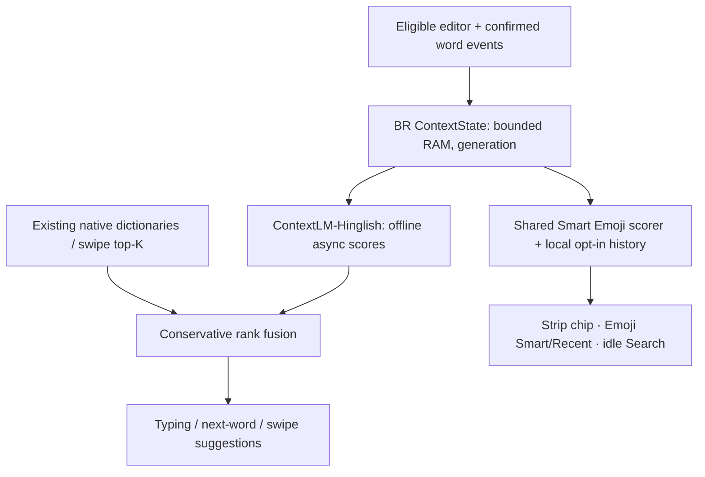

# BR Brain — functional code-level implementation plan (English, Hinglish, Smart Emoji)

> **20 Nov 2026 voice-crash hotfix:** Earlier GTCRN native-enhancement/route telemetry caused or coincided with an owner-reported IME crash 1–2 s after mic tap. For the next release, live capture and Parakeet engine revert to pre-GTCRN code, and BR Brain accurately says “GTCRN filtering paused”. GTCRN stays packaged but inactive. The 0.6B Ultra switch is deferred pending measured North Indian WER, Oppo RAM and latency. This does not change the separate neural ContextLM plan.

> **20 Nov 2026 audio GO (separate implementation):** The built-in GTCRN 535 KB offline denoiser and BR Brain voice-filter performance card are implemented as a source candidate. They do **not** imply the planned neural ContextLM is trained, nor that microphone WER gains or Oppo installation are verified. See [audio-engine contract](GTCRN_AUDIO_ENGINE_IMPLEMENTATION_2026_11_20.md) and current AGENTS/handoff. Original Parakeet stays; new tiny GTCRN lives inside every APK by build-time pinned fetch.

> **Latest owner GO (20 Nov 2026): IMPLEMENTATION AUTHORIZED.** Previous planning pause is historical; begin in tested batches. **Batch 1 source candidate** instruments native per-request typing/after-Space/swipe/Smart-Emoji latency (last/mean/p95 window), manual suggestion taps, honest dashboard explanation and a RAM-only test field; the trained bilingual neural ContextLM is still pending model/data provenance, measurements and device QA. Do not call measured native timing neural-model latency. Further training, score fusion, HMAC and model packaging remain open. See latest AGENTS.md and handoff for live CI state.

Date: 20 November 2026 | Repository: Batmancpu/brrrBoard | Target branch: main | Decision: **PLANNING / IMPLEMENTATION PREPARATION ONLY**.

**Current owner instruction supersedes earlier engineering GO for this turn: DO NOT modify application code, build inputs, models, training assets, CI, releases or installed APK until a fresh explicit “GO”.** Updating implementation documentation and agent handoffs is allowed. Retain current Parakeet 110M TDT INT8 and sherpa-onnx 1.13.3. Future Ultra offline speech and its one-time bundled-APK migration remain separate and frozen. Never infer that a source commit is installed on the owner's Oppo Reno10 5G.

## 1. Definition of done and current truth

**One engine decision:** Build **BR ContextLM-Hinglish v1**, an offline, compact, causal DFSMN sentence-context language model with hashed subword/word features, English + Romanized Hindi mixed-text training, quantized weights, and conservative blending with brrBoard's current dictionary and gesture decoder. Target ~1.5M parameters, <=8 MiB weights, and committed-word inference p95 <=15 ms on the actual Oppo; **these are unproven design budgets**. Neither trained bilingual weights nor a verified data/model license manifest nor Oppo metrics exist today. A model architecture recommendation is NOT a downloadable, tested artifact. If reproducible evaluation fails, keep existing native predictions and rerankers; do not ship placebo weights.

**Existing, committed source (as inspected on main at 73a2ede):**

- `Suggest.kt`: AOSP dictionary next words after Space via `getNextWordSuggestions`, existing swipe candidates and `preferNextWordSuggestion`; native n-grams do some adaptation, but no bilingual neural sentence model.
- `BrrSmartEmojiEngine.java` + `BrrEmojiPatternModel.java`: offline reviewed phrase cues, selected-Emoji 1–3 word association, hashed app/field and global priors, 144-record/45-day TTL, AES-GCM via `BrainLearningVault` in no-backup storage; *unkeyed* truncated SHA-256 fingerprints at present, so decrypted short-word keys can be guessed. This is a coded candidate, not a demonstrated production-quality model.
- Three consumer locations already wired in source: `Suggest.kt` and `SuggestionStripView.kt` (manual contextual Emoji chip / ranking), `EmojiPalettesView.java` Smart/Recent grid, and empty Emoji Search with optional `EmojiDescribeEngine` CLDR enrichment. `BrainDashboardScreen.kt` is titled **BR Brain**, exposing learned-pattern count and erasure. Compiled/published/installed status must be checked per exact commit separately.
- Existing `EmojiContextEligibility` excludes incognito, passwords, no-personalized-learning, no-suggestions, email, URL, code and unknown/non-prose fields. Preserve stricter privacy over the wish to learn from “every field”.

The **missing work** is actual bilingual model training/benchmarking, context-state and async runtime integration, calibrated suggestion fusion, stronger privacy/lifecycle correctness, measured Emoji ranking and Oppo release acceptance. No app files are modified by this plan.

## 2. Architectural contract: one context brain, separate modalities

- The gesture recognizer still proposes words. ContextLM only scores/reranks **surviving native top-K** gesture candidates (no magic recovery when correct word is absent); separate vocabulary/decoder issue is diagnosed and escalated.
- The text predictor may generate a short list of novel next words from the model **only at an empty composing boundary**, constrained by the active lexicon/user dictionary and calibrated score; never replace composed text automatically.
- Emoji recommendation shares the same eligible, immutable context snapshot and editor generation, but can use its existing pattern/history/CLDR signals even when ContextLM is absent. Emoji is **never** typed-word autocorrect and never auto-inserted.
- No external service, model API, analytics or runtime model download in core path. Quantized weights and vocab are APK assets once an implementation passes all gates. This planned bilingual language model is **not** the held Ultra voice recognizer.

## 3. Proposed source/asset API map — exact functions to implement after GO

Paths below are repository-relative and **new files are proposals, not yet present**. Preserve current classes and Java/Kotlin package conventions.

| Contract and ownership | File / function-level entry point | Event and behavior |
| --- | --- | --- |
| Central, immutable context | **NEW** `app/src/main/java/helium314/keyboard/latin/brain/BrBrainContextState.kt`: `onEditorStart(info, generation)`, `onCommittedWord(event)`, `onSelectionChanged(selection)`, `snapshot(): ContextSnapshot?`, `clear(reason)` | Store maximum last 24 completed tokens AND last 160 UTF-16 chars in RAM, with language/script flags, cursor/field generation; no raw sentence persistence. Reject stale selection, undo, paste and protected field. |
| Unified privacy policy | **NEW** `brain/BrBrainEligibility.kt`: `allowInference(info, settings)`, `allowLearning(info, settings)`, `classifySource(event)` | Reuse `EmojiContextEligibility` and Android editor flags; never weaken existing rules. Inference may use only approved prose; learning additionally requires personalization toggle ON and verified user commit. |
| Async bounded inference | **NEW** `brain/BrBrainModelRuntime.kt`: `warmAsync()`, `scoreAsync(snapshot, candidates, requestId, callback)`, `nextWordsAsync(snapshot, requestId, callback)`, `close()` | One lazy local runtime, max one active + one replaceable queued generation; cancel/stale-discard by editor/generation/cursor. No main-thread asset open, crypto or IPC. Error/timeout => native-only. |
| Asset/runtime integrity | **NEW** `brain/BrBrainModelManifest.kt`: `verifyBundledAssets()` + `assets/brain/contextlm_hinglish_v1.{onnx or ort}`, `vocab`, `manifest.json` | Pin trained checkpoint commit, corpus licenses, SHA-256 for model/vocab, operator set, ORT version, quantization recipe, API/ABI coverage, APK delta; never silently fetch weights. Choose `.onnx` versus `.ort` after mobile profiling, not by assumption. |
| Sentence coordinator | **NEW** `brain/BrBrainSuggestionCoordinator.kt`: `onCommit(snapshot)`, `getCachedResult(key)`, `onSwipeCandidates(request, list)`, `invalidateEditor(generation)` | Maintain tiny in-memory cache keyed by editor generation, locale, layout, committed tokens and cursor. Reuse native suggestions if inference not ready; deliver only same-generation results without UI flicker. |
| Safe rank fusion | **NEW** `brain/BrBrainRankFusion.kt`: `rerankNativeTyping(candidates, scores, policy)`, `rerankSwipeTopK(candidates, scores, policy)`, `mergeNextWord(native, neural, lexicon, policy)` | Calibrated log-score blend, dedupe, casing, spacing, exclusion rules. Preserve typed literal, user-resolved swipe correction and native autocorrect acceptance; no forced correction. |
| Opt-in personal style | **NEW** `brain/BrBrainPersonalizationStore.kt`: `recordConfirmedWord(event)`, `scoreBias(snapshot, candidate)`, `forget(scope)`, `count()` | Bounded, decayed, encrypted n-gram and preferred-spelling overlay; reuse native `UserHistoryDictionary` first, avoid double counting. App+prose-field weighting with global fallback; no background “model retraining” from text. |
| Existing typing pipeline hook | `app/src/main/java/helium314/keyboard/latin/Suggest.kt`: `getSuggestedWordsForNonBatchInput`, `getNextWordSuggestions`, `getSuggestedWordsForBatchInput`, `preferNextWordSuggestion` | Retrieve cached context scores, blend without blocking; when composing, use native candidates with guarded rerank, after Space show 2+ strong text suggestions before max 1 manually selected Emoji chip. Native fallback identical when disabled. |
| Existing word-confirmation hook | `app/src/main/java/helium314/keyboard/latin/inputlogic/InputLogic.java`: `commitTyped`, `commitChosenWord`, `getNgramContextFromNthPreviousWordForSuggestion`; `UserHistoryDictionary.addToDictionary` | Emit exactly one `CommittedWordEvent` **after confirmed successful commit**, with source typed/swipe/manual-autocorrect, editor ID, boundary and consent; do not learn raw uncommitted candidates. Capture corrections from verified user action, not guessed intent. |
| Existing lifecycle hook | `app/src/main/java/helium314/keyboard/latin/LatinIME.java`: `onStartInputViewInternal`, `onFinishInputViewInternal`, `onUpdateSelection`, `pickSuggestionManually` | Increment generation/reset context on focus/caret changes and privacy transition. Centralize successful manual Emoji selection signal, preserving exactly-once Recents and no learning for voice/clipboard/recovery. |
| Emoji pattern/privacy repair | `keyboard/emoji/BrrEmojiPatternModel.java`, `BrrSmartEmojiEngine.java`, `EmojiContextEligibility.java`, `latin/brain/BrainLearningVault.java` | Replace future fingerprints with a KeyStore-derived HMAC/salted stable digest, bounded queue + lazy cached prefs, snapshot-before-insert and once-only commit, asynchronous erase completion callback. Legacy encrypted SHA records cannot be rekeyed without plaintext: let old v1 entries age out within 45 days or offer explicit erase; never claim cryptographic migration. |
| Unified Emoji ranking | **NEW** `keyboard/emoji/BrEmojiSuggestionCoordinator.java`: `suggest(snapshot, surface, max, generation)`, `learnOnConfirmedInsert(event)`, `invalidate(generation)` | Wrap existing `BrrSmartEmojiEngine.suggest` and reviewed `EmojiContextScorer` with optional ContextLM semantics; merge `EmojiDescribeEngine` candidates through **one** final dedupe/rank/filter stage; return identical confidence policy across surfaces with surface-specific capacity. |
| Three UI consumers | `keyboard/emoji/EmojiPalettesView.java`: `addRecentKey`, `updateContextSmartPicks`, `updateAdaptiveEmojiOrder`, `prepareSearchIdleSuggestions`, `enterSearchMode`; `suggestions/SuggestionStripView.kt:setSuggestions` | Same immutable eligible snapshot and active editor generation. Smart & Recents opening top row, idle Search first row (no blank), after-Space chip and existing Emoji side suggestions. Keep Recents, skin-tone variants, category, scroll, search results and navigation behavior. |
| Observability and erasure | `settings/screens/BrainDashboardScreen.kt`: existing **BR Brain** page | Show truthful enabled/disabled, local learned word/Emoji record counts, last erase result, and opt-in controls. “Not measured” until an approved on-device benchmark exists. Erase must await worker success and refresh UI; never mix unrelated Recents/voice recovery data. |

### Proposed public data structures (interface design only, not executable code)

- `ContextSnapshot(editorGeneration: Long, fieldScope: String?, localeTag: String, cursorGeneration: Long, completedTokens: List<String>, suffix: String, isProse: Boolean, isPrivate: Boolean)`: immutable, RAM-only; no `EditorInfo` or `InputConnection` retained by worker.
- `CommittedWordEvent(word: String, source: Typed|AcceptedSwipe|ManualSuggestion|AcceptedCorrection, editorGeneration: Long, commitSucceeded: Boolean, isPrivate: Boolean, isFromVoiceOrPaste: Boolean)`: accepted events only; short-lived. Emitting event does **not** mean persisting the raw word.
- `PredictionRequest(requestId: Long, generation: Long, cursorGeneration: Long, mode: Typing|AfterSpace|Swipe|Emoji, candidates: List<String>, deadlineUptimeMs: Long)`; `PredictionResult(requestId, generation, candidateScores, nextWords, confidence, modelHash)`. Never apply a result whose generation/caret/locale differs.
- `EmojiSelectionEvent(preInsertSnapshot, emojiCluster, sourceSurface, confirmedInsertion, generation, fieldScope)`; learn **only** when insertion succeeded into the same original eligible host field. Deduplicate path through strip, panel and `LatinIME`.

### Precise call sequence

1. On `LatinIME.onStartInputViewInternal`: increment generation; clear old buffers; verify `allowInference`; lazy `warmAsync` in background if eligible. Do not inspect previous app text in secure fields.
2. During composing: existing `Suggest.getSuggestedWordsForNonBatchInput` remains authoritative; use already available `NgramContext` and last committed context; optional cached modest rerank, never block key event. If no model result, display exactly native list.
3. On `InputLogic.commitChosenWord` after successful `InputConnection.commitText`: emit exactly one canonical event to context state; optional opt-in local personal bias; queue `nextWordsAsync` for the next Space boundary. Do not enqueue on failed commit, paste, private editor, transcript, recovered voice or spurious selection update.
4. On Space with empty composing word: `getNextWordSuggestions` gets native result and fuses same-generation cached neural next words, lexicon filtered; `BrrSmartEmojiEngine` provides at most one confidence-gated emoji after two text slots.
5. On swipe: native decoder returns candidate list; log **in-memory diagnostic** whether intended word appeared in top 8 only in synthetic/explicit QA; `rerankSwipeTopK` uses cached context model score, never rescues an absent candidate or silently rewrites accepted text. Record correction only upon verified user action.
6. On explicit emoji tap: obtain *pre-insertion* eligible context via cached snapshot or one bounded host `getTextBeforeCursor` read; try insertion; if same editor/generation and success, dispatch one event to existing Recents and shared learner. Update Smart, Recents and idle Search from same rank function. Search CLDR worker results merge only if search generation still current.
7. On cursor move, app/field change, incognito toggle, personalization OFF, service finish or model failure: invalidate generation, discard pending model/emoji results; clear RAM suffix, cancel learning and wipe UI personal candidates; native prediction/normal Recents continue where permitted.

## 4. Training and deployable model reproducibility

1. **Data ledger before training**: use properly licensed conversation-like English, Indian English and Hindi-English code-mixed examples. Candidate primary CC BY 4.0 collections: COMI-LINGUA and HinGE; verify each file's underlying content license, original authors/derivation, terms and split. Not every annotated record is a next-word training sequence. No privately typed text, clipboard, WhatsApp export, protected fields, transcripts or scraped unlicensed social posts. Never incorporate NC/non-commercial corpus into an incompatible distributed artifact.
2. **Tokenizer contract**: word-boundary causal context with hashed subword/character features so Romanized Hindi variants (`nahi`/`nahin`, `jaana`/`jana`), contractions and names are representable. Preserve user spelling, English capitalization, sentence punctuation, code-switches and emojis; never force transliteration to Devanagari. Token budget 24 completed tokens, 160 UTF-16 input suffix.
3. **Network and training boundary**: training happens off-device using only authorized datasets in a controlled environment; deploy inference weights locally as bundled versioned assets. Generate deterministic corpus checksums, licenses/attribution, train/validation/test seed, tokenizer hash, architecture config, checkpoint, quantization calibration and evaluation report. Independent reviewer must be able to reproduce outputs.
4. **Model**: causal compact DFSMN (not 0.6B-class generative model), pretrained **on that verified corpus from scratch**; compare ablations: native n-gram only, ContextLM without personalization, and ContextLM with opt-in overlay. Include direct FUTO English-only ContextLM as **research comparator only**, subject to its model-weights terms requiring visible attribution if adopted; do not imply it has Hinglish coverage or silently copy its inference implementation.
5. **Mobile inference**: ONNX Runtime Mobile quantized CPU first per official mobile guidance; evaluate XNNPACK/NNAPI only if device measurements beat CPU. Lock dependency and operator set, model file hashes and all Android ABIs. Avoid duplicate redundant native runtimes, measure real APK size and RAM; do not accidentally perturb existing sherpa-onnx/Parakeet.
6. **Model artifact approval gate**: a human-readable manifest `docs/brain/MODEL_PROVENANCE.md` (planned) must include model SHA-256, tokenizer SHA, sources/license inventories/attribution, reproducible training commit, tests, Android benchmark, rollback conditions and owner approval. Until this exists, integration may use a **deterministic stub** in tests but not label it trained bilingual intelligence.

Evidence: [FUTO official architecture](https://swipe.futo.tech/) and [released English-only model card](https://huggingface.co/futo-org/futo-swipe); [FUTO model-weights license](https://huggingface.co/futo-org/futo-swipe/blob/main/LICENSE.md); [COMI-LINGUA card](https://huggingface.co/datasets/LingoIITGN/COMI-LINGUA); [HinGE card](https://huggingface.co/datasets/LingoIITGN/HinGE); [ONNX Mobile guide](https://onnxruntime.ai/docs/tutorials/mobile/); [Android editor IPC docs](https://developer.android.com/reference/android/view/inputmethod/InputConnection). FUTO's published English metrics are developer-controlled; not proof of superior Indian English or Hinglish results in brrBoard.

## 5. Ranking policy and product UX (freeze before coding)

- **Native-first safety**: A typed literal stays available; user dictionary names and verified correction winners are protected. If model confidence/margin not calibrated, use native order. Never corrupt URLs, passwords, numbers, code or host editor actions.
- **Candidate recall triage**: if correct swipe word absent from top-8, investigate gesture geometry/decoder/lexicon and Hindi-English vocabulary; if present but ranked badly, ContextLM can help; if top-1 correct but inserted wrong, fix editor commit; if no next-word candidates after Space, inspect NWP candidate generator. These are distinct bugs.
- **Romanized Hindi variants**: normalize for matching/scoring only; preserve chosen spelling verbatim. Word-level adaptive bias is app/field-specific but can back off global and native user history; one erroneous selection must not dominate.
- **Emoji confidence**: phrase/intent cues first (e.g. `happy birthday` => 🎂; `kal birthday hai` => 🎂), then user's confirmed matching phrase/app-field habits, then frequency/Recents. Generic popular emoji never occupy the suggestion strip without context. Smart/Recent and idle Search may show safe fallback picks to avoid emptiness. Preserve skin tone/family as one grapheme/emoji cluster, not random code points.
- **Toggling OFF**: inference/personal learning are separate decisions; personalization OFF stops observing accepted text and reading stored personal scores; incognito or protected context disables inference and learning entirely. Keep a clear per-feature privacy toggle design; no background network.
- **Deterministic fallback**: if assets missing/corrupt, Keystore locked, inference too slow, memory constrained, unknown locale, low confidence or worker crash, return baseline suggestions immediately and count only anonymized in-memory QA events (never context text).

## 6. Priority engineering fixes in existing Smart Emoji candidate

Do these **before** adding learned neural scores after GO:

1. `BrrSmartEmojiEngine.learn` currently queues work onto a `newSingleThreadExecutor` (unbounded queue) and `persist` seals/writes on every selected emoji. Replace with bounded coalesced worker + debounce/flushed transactional writes; test rapid 1000 taps and process death/restart.
2. `BrrEmojiPatternModel.fingerprint` uses first 10 bytes of unkeyed SHA-256 for short predictable phrases and app IDs. Keep AES-GCM envelope but require keyed HMAC under separate Keystore-managed material for future records; migrate by version with TTL or explicit consent (raw old words do not exist for lossless rehash). No cloud secret backup.
3. `EmojiPalettesView.addRecentKey` reads the editor's `getTextBeforeCursor(160,0)` around Emoji submission; establish one *pre-commit snapshot*, and learn only after success. Handle `LatinIME.pickSuggestionManually` panel-null path without duplicate events. Avoid binder reads on each keystroke.
4. `suggest` queries preferences/Adaptive Emoji candidates on render path. Cache preference eligibility and short Recents in memory, invalidate on settings/usage, prove no blocking disk on UI thread.
5. `forgetLearnedPatterns` is asynchronous but current dashboard can briefly display stale count. Add completion/failure result, serialize behind pending learn writes, then update UI and verify no reappearance after restart. Consent-off must cancel pending writes, not simply hide them.
6. `EmojiDescribeEngine` async Search semantic result path and `BrrSmartEmojiEngine` synchronous ranking have distinct merge paths; introduce one final shared coordinator with dedupe, eligibility, generation token and safe fallback so all three surfaces have identical *relative context* ranking when eligible.
7. Current 144-entry/45-day store and handpicked confidence thresholds (500/520) are engineering defaults, not precision measurements. Measure hit-rate, false suggestions, app isolation and retention on reproducible synthetic/consented fixtures before choosing larger bounds or thresholds. Avoid hidden per-app identity leaks.

## 7. Acceptance fixtures, performance gates and privacy proof

All metrics compare **the same native baseline and experiment on the same held-out inputs**, separately for standard English, North Indian Indian English, Romanized Hindi and mixed Hinglish. Seed fixtures before training; dedupe similar sentence templates and split by writer/conversation to avoid leakage. Opt-in human test text must never be uploaded or logged by the keyboard.

| Test / gate | Minimum explicit acceptance criterion |
| --- | --- |
| Predictor held-out | Pre-register at least 1,000 independent Hinglish, 500 Indian-English, and 500 English next-word test contexts; report top-1 and Recall@3, OOV, code-switch boundary and calibration. Target **>=5 percentage-point** Hinglish Recall@3 improvement versus native; <=1 percentage-point regression in either English group. If not met, do not default-enable neural fusion. |
| Gesture diagnostic | At least 300 paired QWERTY gestures including Indian-English/Hinglish words: report correct target absent/present top-8 and top-1 conditional on present; target positive paired top-1 improvement without increased false auto-commit/correction; investigate missing-lexicon separately. Synthetic trajectories and explicit QA only. |
| Emoji utility | At least 200 contextual multi-app cases (positive, ambiguous, negative, empty Search, 3 surfaces). Target contextual strip Precision@1 >=90% on approved intent-bearing fixtures; no irrelevant strip chip in negative prompts; equal ranking by input snapshot across surfaces; fallback nonblank when eligible. |
| Personal learning | Multiple approved prose apps/fields, normal and Romanized Hindi spelling variants. Verify an explicitly selected next word/Emoji increases rank **only** in matching scope then backs off global; no learning from discarded suggestions, raw voice, paste, clipboard or undo. |
| Security/privacy | Unit + instrumentation checks for password, email, URL, code, username, private, no-suggestions, no-personalized-learning, toggle OFF, failed commit, stale editor and process kill: **zero content capture, zero record write and zero UI leak**. HMAC/AES/TTL/corrupt-file tests, exact erasure and no network with airplane mode. |
| Responsiveness | Oppo Reno10 5G measured committed-word model inference **p95 <=15ms target**; keyboard main-thread no model/asset/disk/host IPC wait; no lost frames, freezes or sustained battery/thermal spikes versus baseline; measure median/p95 cold and warm, APK delta, RAM. If unmet, shadow-only or revert. |
| UX and accessibility | Suggestion strip preserves native top 2 text positions, no unsolicited Emoji insert; Scroll/category/Recents and blank-search defaults intact, skin tone/ZWJ correct, TalkBack labels, portrait/landscape; app switch and caret generation safe. |
| Regression and release | All impacted JVM/instrumentation tests, lint/compile and debug CI pass on **exact candidate SHA**; original-signed Obtainium release must independently pass exact SHA, sign with original cert and package `com.mangoloads.board`, keep user data and Parakeet 110M, and then get real Oppo upgrade/airplane-mode acceptance. Never claim install success from a merged commit. |

**Diagnostic scenario ledger** (at least): `kal office jaana hai` -> relevant Romanized Hindi next word versus `the office is open` -> English; `mujhe kal` vs `mujhe kaal` (do not overwrite intended spelling); `please send the` -> contextually suited noun, not global “the”; `happy birthday` / `kal birthday hai` -> 🎂, `thanks yaar` -> 🙏/❤️ only if user confirmed preference, `bank account` must not blindly trigger 💰; WhatsApp normal prose vs notes prose different EMA histories; same app with non-prose search input no learning; fast field switch while inference pending; Emoji tap with IME panel not initialized; private mode erase/reopen; end-of-sentence and trailing punctuation; keyboard rotation and Back/recents reentry; voice result and recovered rail do not teach personalization.

## 8. Implementation and merge sequence when user says GO

- **Batch 0 — baseline and training spec (no APK changes):** freeze metrics, legal corpus ledger, synthetic+permitted evaluation fixtures, baseline n-gram/gesture/Emoji performance; choose dependency and memory budget after device measurements. Exit: published reproducible baseline and model data approval. If this fails, pause.
- **Batch 1 — emoji reliability/security:** dedupe selected-Emoji event, precommit snapshot, HMAC v2/fallback/erase, bounded IO, shared final ranker and 3-surface instrumentation. Exit: privacy and precision gates, baseline BR Brain truthfulness.
- **Batch 2 — context/model trained in isolation:** train bilingual ContextLM; export quantized model; verify corpus license, full SHA/provenance, model output test vectors; bundle as private APK asset only after model gate. Exit: reproducible offline fixed vectors and Oppo latency. If absent, no fake binary.
- **Batch 3 — shadow coordinator:** implement eligible per-editor RAM lifecycle + generated request cancellation, runtime and fusion in **shadow mode** against native, with no user-visible rank change. Exit: no main-thread regressions, comparable pairwise evaluation, private-field and stale-response tests.
- **Batch 4 — guarded typing and swipe:** enable after-Space next word / conservative swipe rerank behind a local rollback flag, calibrate per English/Hinglish cohort; no forced replacement of selected text. Exit: accuracy thresholds and no unintended correction/insert regressions.
- **Batch 5 — personalization and BR Brain:** word-style n-gram personal overlay and emoji app/field specificity, opt-in + erase callback, honest dashboard metrics, three UI surfaces final. Exit: erase/restart/privacy and visual accessibility acceptance.
- **Batch 6 — release:** exact-main-SHA CI, preserve original signature/package, optional signed Obtainium update **only after** owner authorization and tests; verify upgrade and offline Oppo against installed app, including intact Parakeet. Update release notes and all handoffs with SHA, workflow IDs, test failures and device outcomes. Roll back feature flag, not app identity, if quality regresses.

**Merge rules for any future agent:** work only on `main`, read latest HEAD/changed files before editing, preserve concurrent edits, do not force push or create an extra branch. Update `AGENTS.md`, `PROJECT_CONTEXT.md`, `docs/ENGINEERING_HANDOFF.md`, this file, relevant existing topic plan and release notes when application behavior changes. Stage and report actual evidence after each batch; never invent build, signing, model performance or phone installation. **Current status: batches 0–6 pending new owner GO, no code changes in this planning turn.**

## 9. Implementation-ready unresolved prerequisites (must be settled by evidence)

1. Licensed English/Hinglish train/eval datasets with model card provenance and permission to redistribute derived weights.
2. Concrete trained quantized model file + vocab + checksums; no claim that FUTO's *English-only* weights give the best Hinglish performance.
3. Oppo Reno10 5G baseline test harness, honest measurements and threshold calibration.
4. Explicit feature-setting UX for sentence inference/personal learning, preserving currently stored privacy flags, existing Recents and erasure.
5. Careful fixed commit-source compile/CI and user acceptance; as of document creation the inspected head was `73a2ede` and latest workflow status was pending. Refresh it; it may have advanced after this plan.

**Next authorized step:** wait for owner's explicit “GO implement BR Brain plan”. No implementation, model swap, APK build or installation is performed by this document.